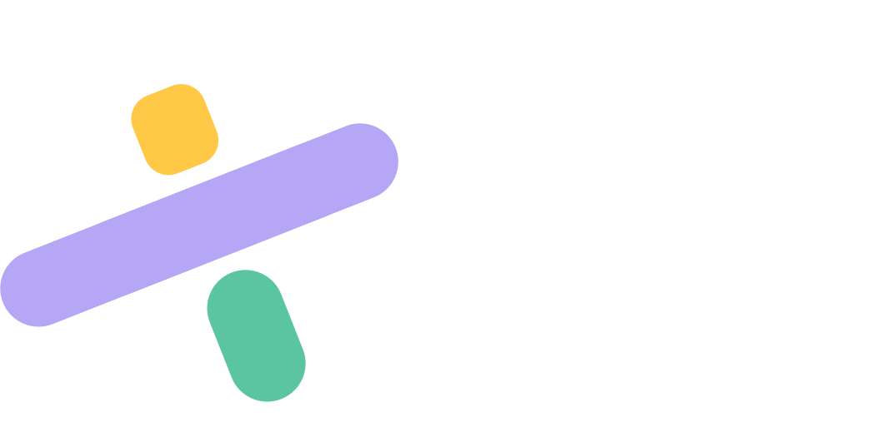

<br><br>

# reportix Handbuch für Gleichstellungskonzepte in Bayern

Willkommen im **reportix Handbuch** Repository
Der Code erstellt mit [Quarto](https://quarto.org) ein Online-Buch. 

## Über das Buch
Das Handbuch beschreibt die Funktionsweise von reportix in der Anwendung auf Gleichstellungskonzepte in bayrischen Behörden.
Zielgruppe sind Anwender:innen, also Personen in der Personalverwaltung.

## Erste Schritte
Um das Buch lokal auf deinem Computer anzuzeigen und zu erstellen, muss [Quarto](https://quarto.orgdocs/get-started/) installiert sein.

### Download
Klone dieses Repository auf deinen lokalen Computer:
```bash
git clone git@github.com:ondatix/stmas-reportix-Handbuch.git
```

### Text Anpassen
Jedes Kapitel im Buch ist ein eigenes `.qmd`-File in diesem Repository.
Um Texte im Buch zu ändern, editiere das jeweilige `.qmd`-File in einem beliebigen Editor (z.B. RStudio oder VS Code). 
Die erste Seite im Buch ist `index.qmd`.

Editiere niemals Text im Ordner `_book/`, da diese überschrieben werden, wenn das Buch neu gerendered werden (siehe unten).

### Struktur ändern
Um die Struktur des Buches zu ändern, editiere `_quarto.yml`. 
Hier kannst du z.B. Kapitel vertauschen oder ein anderes Logo festlegen.

### Live-Vorschau
Du kannst dir das Buch während des Schreibens oder Bearbeitens in Echtzeit anzeigen lassen. Führe dazu folgenden Befehl im Terminal aus:
```bash
quarto preview
```
Dies rendert das Buch und öffnet eine Live-Vorschau in deinem Webbrowser.

### Rendern (Erstellen)
Um das finale Ausgabeformat (oder Formate) ohne den Vorschau-Server zu erstellen, nutze diesen Befehl:
```bash
quarto render
```
Dies rendert in alle Formate, die unter `format:` im `_quarto.qml` gelistet sind.

Du kannst auch nur ein Format generieren (z.B. nur PDF):
```bash
quarto render --to pdf
```

Die fertig kompilierten Dateien liegen anschließend im Ordner `_book/`.
Dieser Ordner is nicht unter Versionskontrolle, da er ohnehin automatisch generiert wird.
Mehr Hilfe zum rendern [hier](https://quarto.org/docs/cli/render.html#examples).

## Mitwirken (Contributing)
Beiträge, Vorschläge und Korrekturen sind herzlich willkommen! 
* Reiche bei kleinen Tippfehlern gerne direkt einen Pull Request ein.
* Öffne bei größeren Änderungen bitte zuerst ein [Issue](https://github.com/ondatix/stmas-reportix-Handbuch/issues), um dein Vorhaben vorab zu besprechen.

## Lizenz
Dieses Werk ist lizenziert unter einer [Creative Commons Namensnennung - Weitergabe unter gleichen Bedingungen 4.0 International Lizenz](https://creativecommons.org).

