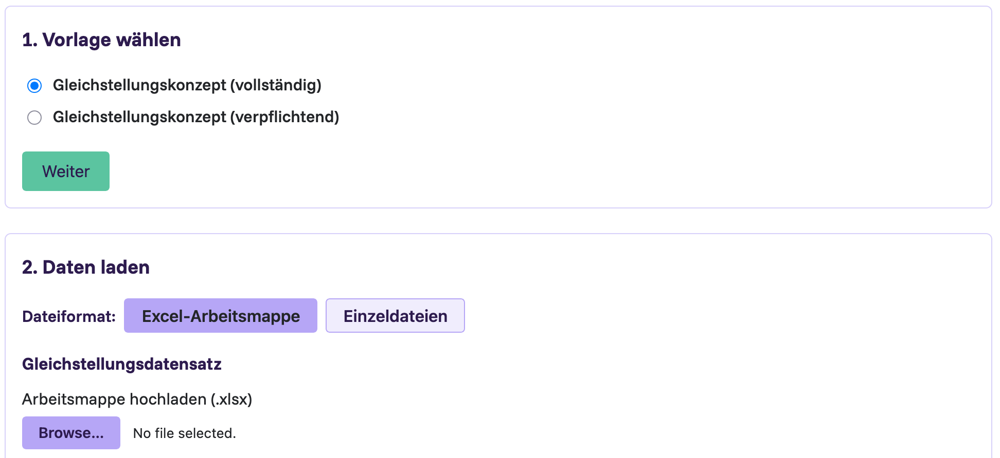

## Willkommen {.unnumbered}

::: {.callout-caution}
## Under Construction

Dieses Handbuch ist noch in Bearbeitung. Bitte mit Vorsicht genießen ;)
:::

Dies ist das Nutzer:innenhandbuch für die Erstellung von Gleichstellungskonzepten in Bayern mit Reportix.

::: {.grid .gap-3 .pb-3 .pt-4}
::: {.g-col-12 .g-col-sm-4}
[Quick Start](quick-start.qmd){.btn .btn-primary .w-100 .btn-lg .rounded-pill}
:::
::: {.g-col-12 .g-col-sm-4 .mb-2}
[Handbuch](datenvorbereitung.qmd){.btn .btn-secondary .w-100 .btn-lg .rounded-pill}
::: 
::: 

## Was ist Reportix?

Reportix ist ein Tool zur teil-automatisierten Erstellung von Gleichstellungskkonzepten in bayrischen Behörden.

Ein paar klicks und Sie erhalten ein vorformuliertes, datenschutzkonformes und barrierefreies Gleichstellungskonzept mit Grafiken und Tabellen als Word- oder odt-Dokument.

