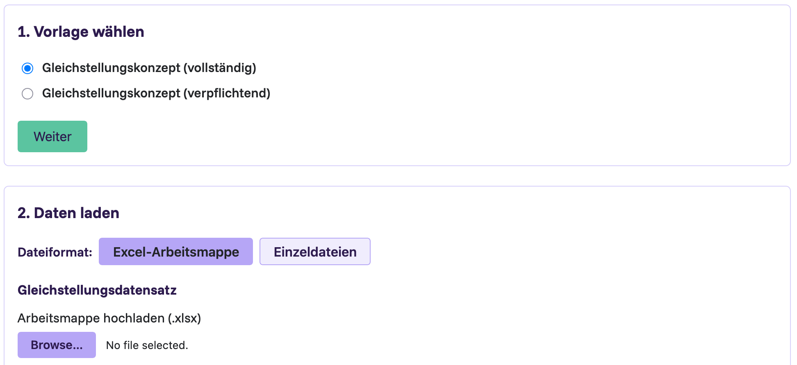

# Quick Start {.unnumbered}

::: {.callout-caution}
## Under Construction

Dieses Handbuch ist noch in Bearbeitung. Bitte mit Vorsicht genießen ;)

Stand: Wenige TODOs offen
:::

## Gleich loslegen!

Einfach auf 

[gleichstellung.bayern.ondatix.org](https://gleichstellung.bayern.ondatix.org){.btn .btn-primary .rounded-pill target="_blank" rel="noopener"}

gehen und **reportix** ausprobieren.

> TODO: richtiger link

---

> TODO: Gif oder Video einfügen

## Die wichtigen Schritte

::: {.grid}

::: {.g-col-4}
::: {.callout-important icon=false}
## (1) Vorbereitung: Daten 

Datensätze im `csv`- oder `xlsx`-Format mit einer Zeile pro Person/Ereignis.

[Mehr](datenvorbereitung.qmd){.btn .btn-secondary .btn-sm .rounded-pill}
:::
:::

::: {.g-col-4}
::: {.callout-note icon=false}
## (2) Arbeit in **reportix**

- Daten laden
- Einstellungen auswählen
- Dokument exportieren als `docx` oder `odt`

[Mehr](webapp.qmd){.btn .btn-secondary .btn-sm .rounded-pill}
:::
:::

::: {.g-col-4}
::: {.callout-important icon=false}
## (3) Nachbereitung: Dokument 

Eigene Inhalte hinzufügen und Texte bearbeiten.

[Mehr](nachbereitung.qmd){.btn .btn-secondary .btn-sm .rounded-pill}

:::
:::

:::

