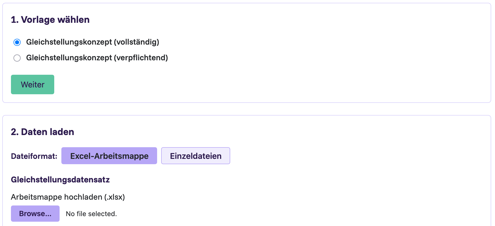
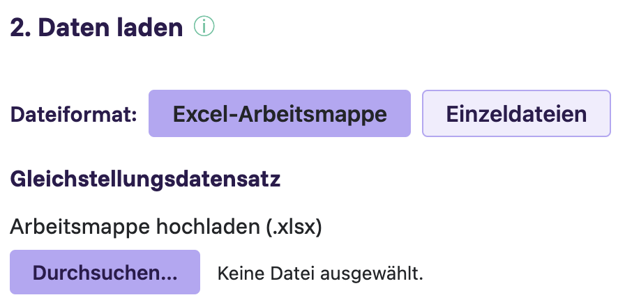

# Arbeit mit der Web-App reportix

::: {.callout-caution}
## Under Construction

Dieses Handbuch ist noch in Bearbeitung. Bitte mit Vorsicht genießen ;)

- TODO: Kleine TODOs (s.u.) fixen
:::

::: {.callout-warning}
## Wichtige Hinweise um den sicheren Umgang mit **reportix** zu gewährleisten

- Nutzen in **reportix** in einer aktuellen Browserversion.
- Teilen Sie *keine* Screenshots oder Bildschirmaufnahmen von **reportix** oder den Daten.
:::

Um die Web-App im vollen Umfang nutzen zu können, bereiten Sie die Daten gemäß @sec-datenvorbereitung vor.

Die Web-App erreichen Sie unter [https://gleichstellung.bayern.ondatix.org/](https://gleichstellung.bayern.ondatix.org/).

## Vorlage wählen

Wählen Sie die zu erstellende Vorlage. Die Auswahl bestimmt, welches Musterkonzept (siehe @sec-musterkonzept) zugrunde gelegt wird und welche Daten im nächsten Schritt abgefragt werden.

::: {.grid}

::: {.g-col-6}

::: {.callout-tip icon=false}
## Gleichstellungskonzept vollständig (*empfohlen*)

Wir empfehlen, das vollständige Gleichstellungskonzept mit allen Inhalten (Pflichtinhalte und optionale Inhalte) zu erstellen.

Sie haben immer die Option, Inhalte im erstellten Dokument wieder zu löschen, da dies editierbar ist.
:::

:::

::: {.g-col-6}

::: {.callout-note icon=false}
## Gleichstellungskonzept minimal (nur Pflichtinhalte)

Das minimale Gleichstellungskonzept beschränkt sich ausschließliche auf die Pflichtinhalte.

Wir empfehlen dies nur zu nutzen, wenn Sie sicher sind, dass sie *keine* der optionalen Inhalte einfügen möchten.
:::

:::

:::

::: {.shadow .rounded .p-2}

:::

## Daten laden

Nun geht es schon daran die Daten in Reportix zu laden. 
Falls Sie das noch nicht getan haben, empfehlen wir zunächst @sec-datenvorbereitung zu lesen.

::: {.shadow .rounded .p-2}
{width=50%}
:::
 
Gehen Sie wie folgt vor:

1. **Dateiformat wählen**: Hier können Sie -- wie in @sec-dateiformate beschrieben -- zwischen einer Excel-Arbeitsmappe oder Einzeldateien (`xlsx` oder `csv`) enschtscheiden.
2. **Datei(en) hochladen**: Klicken Sie auf `Durchsuchen...` und wählen Sie die entsprechende Datei(en) aus. 
3. **Detail-Einstellungen**: Wenn Sie die Dateien wie in @sec-standards beschrieben vorbereitet haben, sollte reportix automatisch die richtigen Einstellung bzlg. Tabellenblättern und Merkmalen (Spalten) treffen. Wenn aber z.B. die Spalten in Ihrer Datei andere Namen haben, können Sie in diesem Schritt die Zuordnung treffen. 

::: {.shadow .rounded .p-2}

:::

## Berichtsparameter

In diesem Schritt wählen Sie die Formatierung ihres Gleichstellungskonzeptes aus.    
*Keine Angst: Bis auf die Farben der Grafiken können Sie alles am Ende auch im entstandenen Dokument noch editieren.*
Bei der ersten Nutzung von reportix können Sie auch alle Werte (bzw. leeren Felder) so belassen wie vorgegeben. 
Lediglich die Behörde empfehlen wir anzupassen.

- **Titel**: Wählen Sie einen Titel für Ihr Konzept.
- **Behörde**: Für welche Einrichtung wird das Konzept verfasst?
- **Schriftart**: Hier können Sie eine Schriftart auswählen.
- **Farpalette für Grafiken**: Hier können Sie zwischen verschiedenen barrierefreien Farbpaletten wählen. 
- **Schriftgröße des Texts (pt)**: Wählen Sie hier die Standard-Schriftgröße für den Text.
- **Überschriftenfarbe (Hex ohne #)**: Hier können Sie die Farbe von Überschriften einstellen. Sie finden Farben Ihrer Einrichtung im Corporate Design. Der Default-Farbton ist `#1F3864`, was ein dunkles Blau ist. `#008dc9` wäre z.B. das Bayern-Blau. Mehr zu Hex-Farben finden Sie [hier](https://de.wikipedia.org/wiki/Hexadezimale_Farbdefinition).
- **Seitenausrichtung**: Wählen Sie zwischen Hoch- und Querformat. In der Regel empfehlen wir Hochformat.
- **Kopfzeilentext**: Sollten Sie einen Text in der Kopfzeile wünschen, können Sie diesen hier angeben.
- **Fußzeilentext**: Sollten Sie einen Text in der Fußzeile wünschen, können Sie diesen hier angeben.
- **Seitenzahlen**: Möchten Sie Seitenzahlen links, zentriert, rechts oder gar nicht anzeigen?
- **Dateiname der Ausgabe**: Wie soll das Dokument benannt werden?
- **Dokumentbetreff**: TODO
- **Dokumentersteller**: TODO
- **Schwellenwert kleinste Gruppe**: Dies ist eine Datenschutz-Einstellung. Wenn weniger als in diesem Feld angegebenen Personen ($x$) in einer Gruppe sind, wird $<x$ angezeigt anstelle des tatsächlichen Werts.
- **Überschriften nummerieren (1., 1.1., …)**: Sollen die Kapite und Unterkapitel im Konzept nummeriert werden? Wenn ja, setzen Sie ein Häckchen.
- **Inhaltsverzeichnis einfügen**: Soll ein Inhaltsverzeichnis generiert werden? Wenn ja, setzen Sie ein Häckchen.

## Bericht erstellen und exportieren

Klicken Sie `Bericht erstellen`, betrachten Sie die Vorschau und gehen Sie ggf. noch einmal zurück um Einstellungen anzupassen.

Ist alles in Ordnung? Dann können Sie `Als .docx exportieren` klicken und damit das Konzept erstellen.

